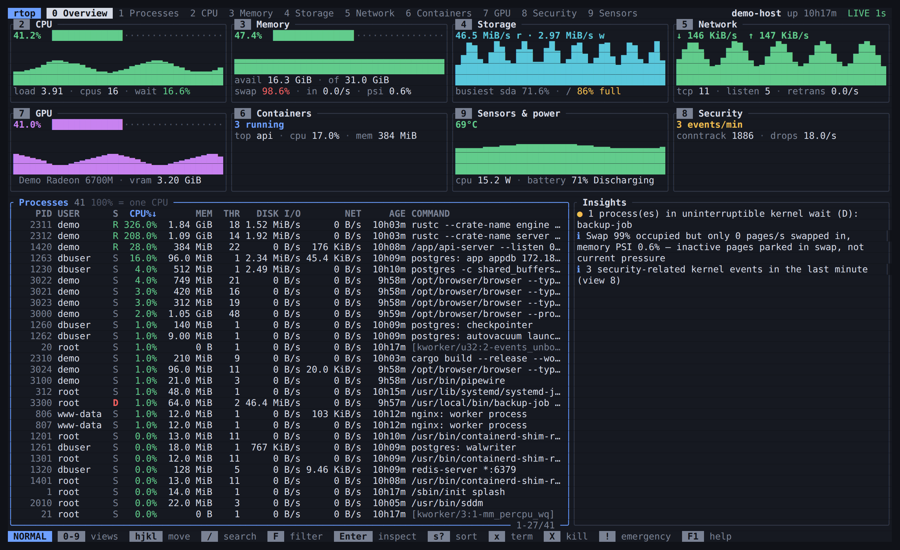
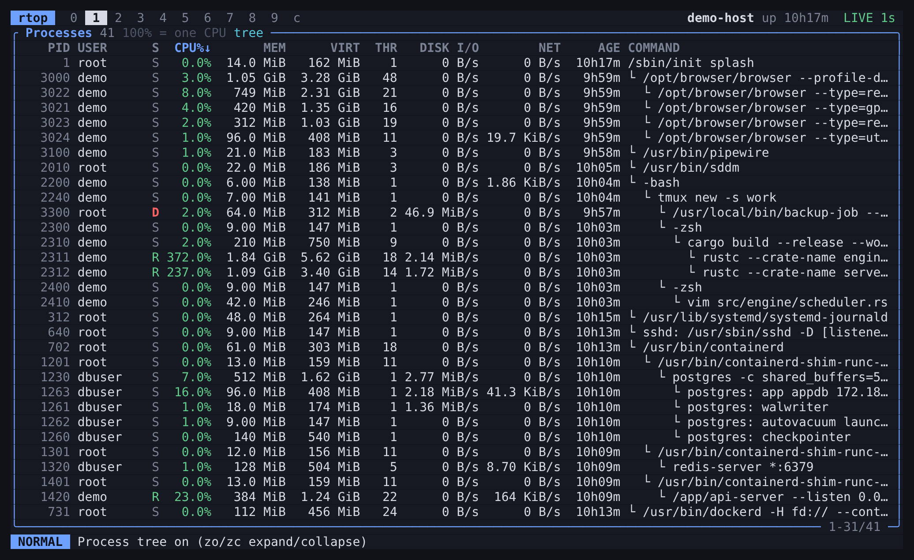
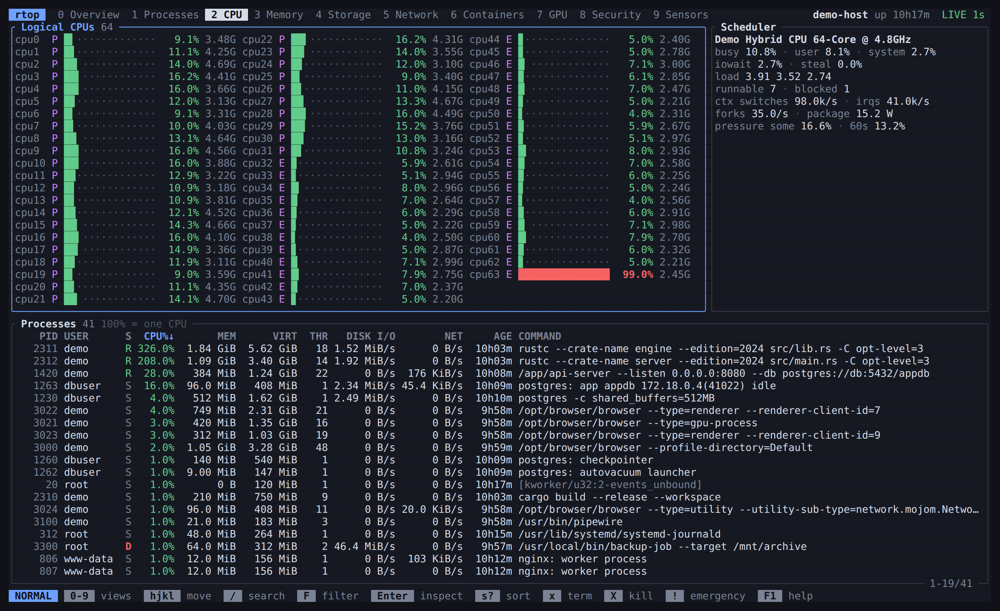
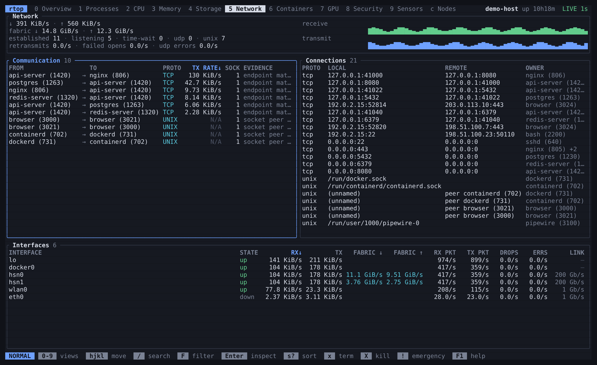
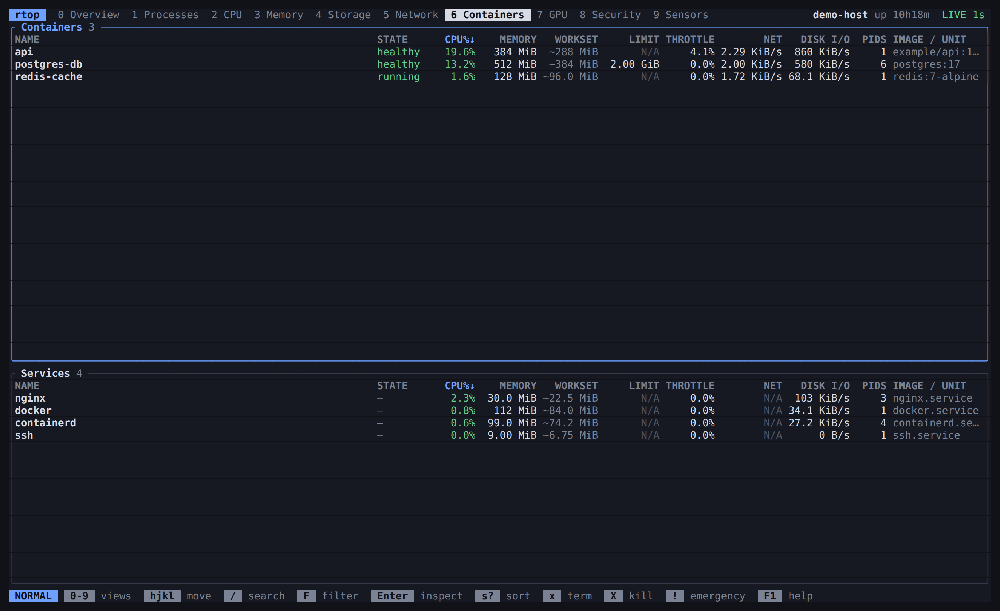
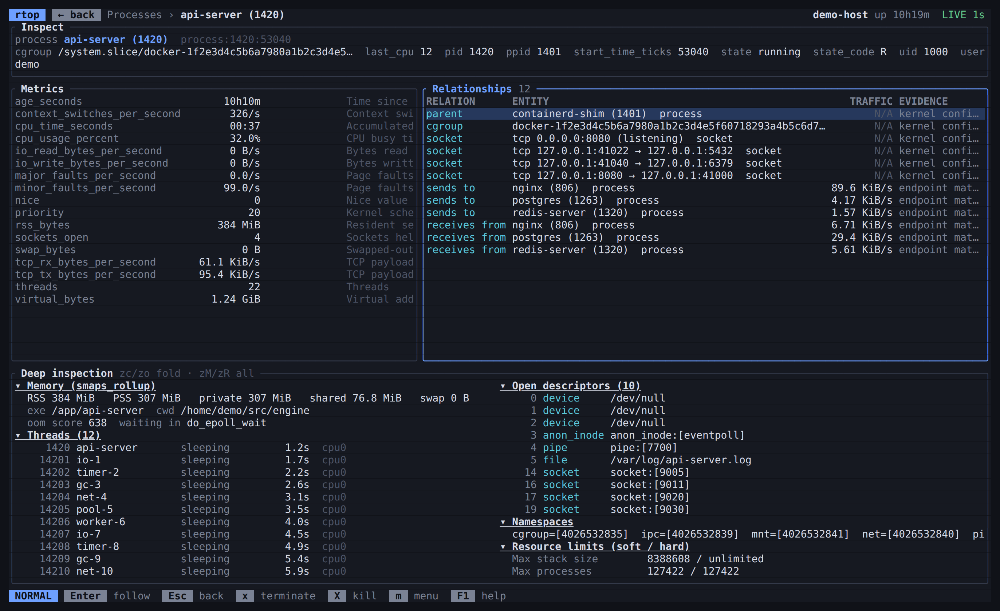
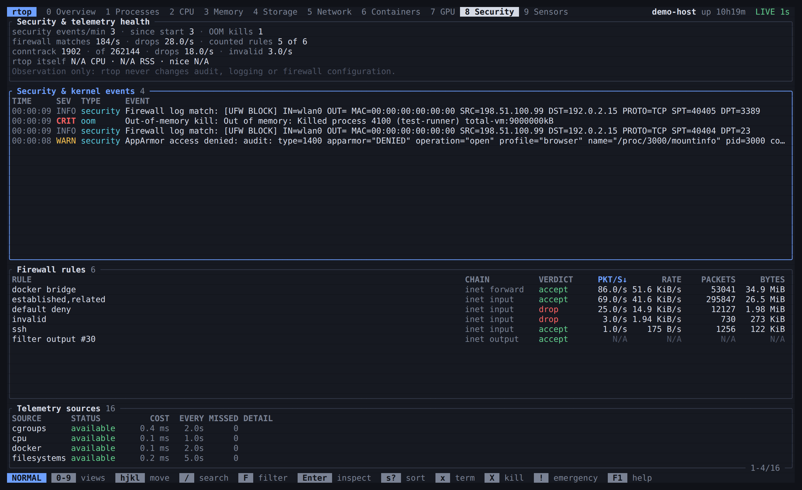
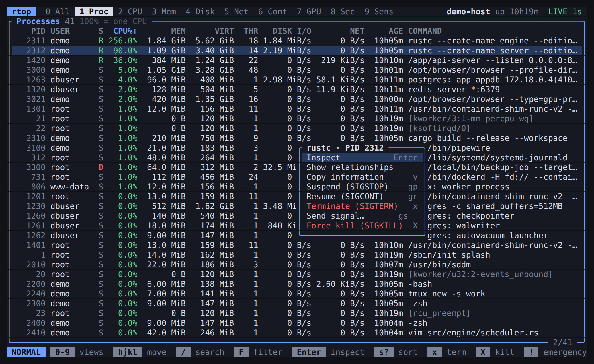
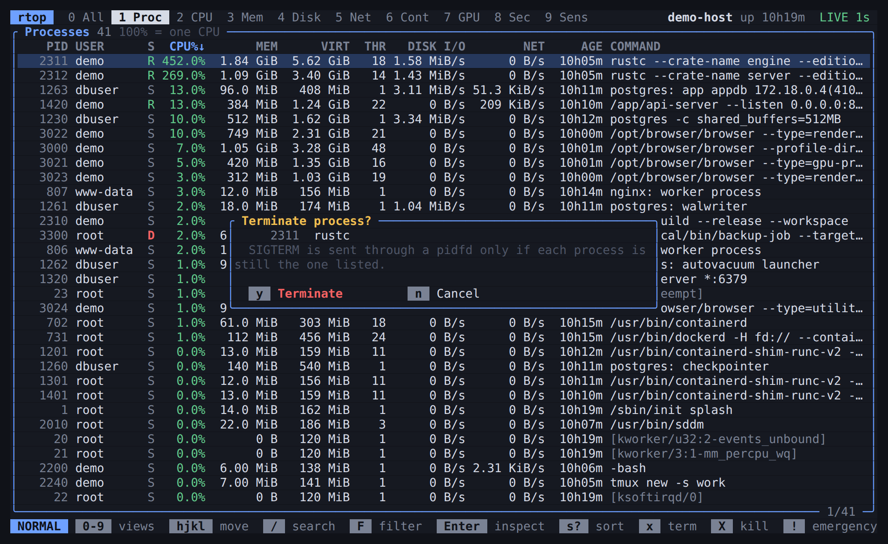
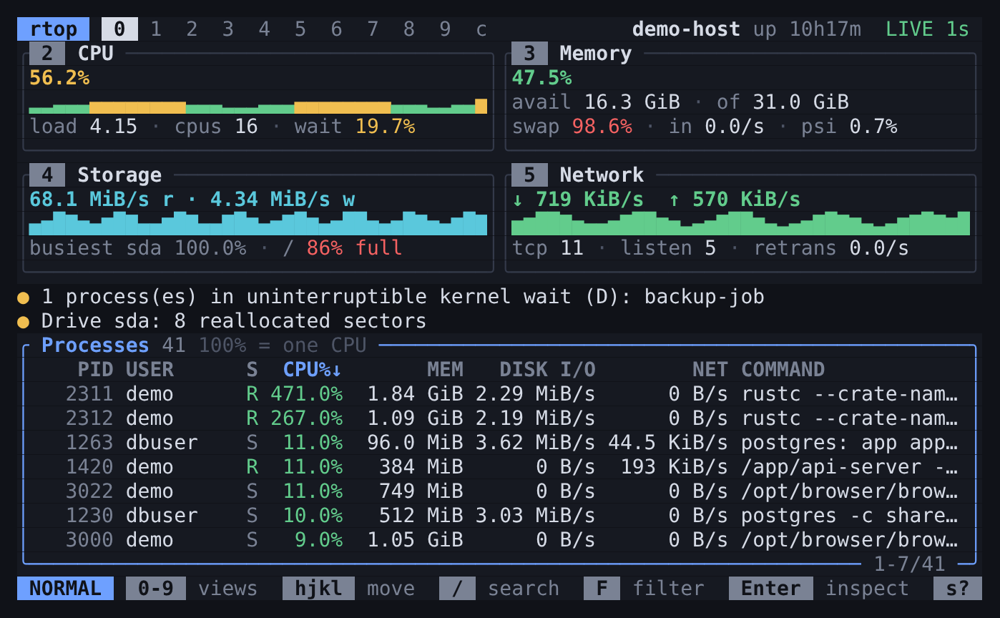

# RTOP - The Only Linux System Monitor You Need

rtop is a real-time Linux system monitor and process manager written in Rust.
It collects CPU, memory, pressure, processes, storage, network, sockets,
containers, GPUs, sensors and security events into **one connected telemetry
graph**, shows that graph in a keyboard- and mouse-driven terminal UI, and
prints the same graph as YAML or JSON with `rtop --stats`.



*All screenshots in this README show `rtop --demo`: a built-in, fully invented
machine. No real system appears in them.*

## Why the claim holds

The title is a strong claim. This is the argument for it, and the
[limitations](#limitations) section says where it stops.

### 1. One tool for live diagnosis

A typical investigation switches between half a dozen tools. rtop covers the
same ground in ten views that share one data model:

| Question | What you would otherwise reach for | rtop view |
| --- | --- | --- |
| What is using CPU and memory? | `top`, `htop`, `btop` | `0` Overview, `1` Processes |
| Which cores are busy, and are tasks waiting? | `mpstat`, `/proc/pressure` | `2` CPU |
| Is swap a problem or just occupied? | `free`, `vmstat` | `3` Memory |
| Which disk and which process do the I/O? | `iostat`, `iotop`, `df` | `4` Storage |
| Who talks to whom, and how much? | `ss`, `nethogs`, `lsof -i` | `5` Network |
| Which container or service is throttled? | `docker stats`, `systemd-cgtop` | `6` Containers |
| What is the GPU doing, and for whom? | `nvtop`, `radeontop`, `nvidia-smi` | `7` GPU |
| Were there denials, OOM kills, conntrack drops? | `dmesg`, `conntrack -S` | `8` Security |
| Temperatures, fans, power, battery? | `sensors`, `upower` | `9` Sensors |
| What exactly is this process holding open? | `lsof`, `pmap`, `/proc/PID/*` | `Enter` on a process |

rtop is a tool for diagnosing a machine *now*. It does not replace those tools
for everything they do (see [limitations](#limitations)).

### 2. Everything is connected

Collectors do not fill separate tables. They publish nodes and edges into one
graph: processes are `member_of` cgroups, containers are `accounted_to` them,
processes `owns_socket` sockets, sockets are `connected_to` their peers,
volumes are `backed_by` filesystems, processes `uses_gpu` a GPU. `Enter`
follows a relationship; `Ctrl+o` goes back.

That makes a path such as *busy container → its processes → their sockets →
the process on the other end* a matter of a few key presses.

Relationships are only asserted with evidence, and the evidence is shown:

- **kernel confirmed** — for example `/proc/PID/fd/N` links to the socket inode.
- **socket peer confirmed** — the kernel's `UNIX_DIAG_PEER` names the other
  end of a Unix socket.
- **endpoint matched** — both ends of a TCP connection were observed in this
  namespace with mirrored addresses.

Process-to-process communication is derived from these and is never inferred
from addresses that merely look compatible.

### 3. Missing data is never shown as zero

A measured zero and "could not measure" are different types in rtop. Anything
without a value carries a reason, in the UI and in the export:

| Shown as | Reason in `--stats` | Meaning |
| --- | --- | --- |
| `…` | `pending`, `counter_reset` | A rate needs a second sample, or a counter restarted |
| `N/A (perm)` | `permission_denied` | The kernel refused access |
| `N/A (unsup)` | `unsupported` | Kernel, driver or hardware does not expose it |
| `N/A (off)` | `disabled` | Its collector is switched off (emergency mode) |
| `N/A (idle)` | `not_collected` | Not subscribed to in the current view |
| `N/A` | `not_measurable` | Cannot be measured cheaply or reliably |
| `N/A (bad)` | `invalid_data` | The source returned data rtop could not interpret |
| `N/A (gone)` | `removed` | The entity disappeared during sampling |
| `N/A (timeout)` | `timed_out` | The provider missed its deadline |

Two more markers apply to values that do exist: **stale** (the collector that
produced the value is overdue or blocked, so the last reading is kept and
marked) and **estimated** (derived by a heuristic, such as a container's
working set, shown with a leading `~`).

The same honesty applies to interpretation. The *Insights* panel states
hypotheses with their evidence, for example "Swap 99% occupied but only 0
pages/s swapped in — inactive pages parked in swap, not current pressure".
When the data needed for a judgement is missing, rtop says so or says nothing.

### 4. Actions cannot hit the wrong process

A PID can be reused between the moment you look at a row and the moment you
press a key. rtop identifies a process by PID *and* start time, opens a pidfd,
verifies that the pidfd still refers to that exact process, and only then
sends the signal through the pidfd. A mismatch aborts with "not sent".

Delivery is not reported as success. After a terminating signal rtop observes
whether the process actually exited, and reports a process stuck in
uninterruptible sleep (state `D`) as still present instead of claiming it was
killed. On kernels without pidfd, actions are disabled rather than done with a
racy fallback.

### 5. It stays usable when the system is not

A monitor is needed most when the machine is overloaded. The runtime is built
around that case:

- Every collector runs on its own worker thread with its own deadline. A slow
  collector misses deadlines (which are counted) and has its interval
  stretched; it never queues work.
- A collector that blocks in the kernel is marked *blocked*, its last data
  stays visible as stale, and no replacement thread is spawned.
- `statvfs()` on remote filesystems runs on helper threads with a deadline, so
  a dead NFS server parks at most one thread per mount and nothing else.
- The event loop drains keyboard input before telemetry and executes a key's
  effect (such as a kill request) before rendering.
- Terminal output goes through a writer thread. If the terminal stops reading
  (a stuck SSH session, a paused tmux pane), rendering is skipped; input and
  actions do not wait for it.
- `!` switches to emergency mode: only the essential collectors (host, CPU,
  memory, pressure, processes, rtop's own overhead) keep running.
- rtop reports its own CPU, memory and thread count, and the cost and missed
  deadlines of every telemetry source, in view `8`.

### 6. Everything on screen is scriptable

`rtop --stats` prints the complete graph with a versioned schema, so the data
behind the UI is available to scripts without screen scraping:

```sh
rtop --stats --json | jq '.nodes[] | select(.kind == "host") | .metrics.cpu_usage_percent'
```

## A short tour

**Process tree** (`t` in view `1`). CPU is in the per-CPU convention (100% =
one CPU). The red `D` marks a process in uninterruptible kernel wait.



**CPU** (`2`). Per-logical-CPU usage and frequency with performance (`P`) and
efficiency (`E`) core types read from sysfs, next to scheduler statistics and
CPU pressure.



**Network** (`5`). Process-to-process communication with protocol, rate and
evidence; every socket with its owner; interface counters. Unix-socket traffic
shows `N/A` because the kernel keeps no byte counters for it.



**Containers and services** (`6`). cgroup v2 accounting joined with Docker
metadata. `WORKSET` values carry `~` because they are estimates; an unlimited
memory limit is `N/A`, not `0`.



**Inspecting a process** (`Enter`). Metrics with descriptions, relationships
with traffic and evidence, and on-demand deep inspection: `smaps_rollup`
memory, threads, open descriptors, namespaces and resource limits.



**Security and telemetry health** (`8`). Kernel-log denials, OOM kills and
firewall log matches, conntrack counters, per-rule nftables hit rates, and the
state of every collector.



**Actions.** `m` or a right click opens the action menu; `x` asks before
sending SIGTERM and states how the signal will be delivered.





**Small terminals.** Layouts adapt to the available size. This is 80×24:



## Install

Requirements:

- Linux. rtop reads procfs, sysfs, netlink and cgroup v2.
- Rust 1.89 or newer to build.
- Linux 5.3 or newer for process actions (pidfd). Monitoring works without it.

```sh
make build/release        # optimised binary at target/release/rtop
make install              # installs ~/.local/bin/rtop and the rtop(1) man page
make install PREFIX=/usr/local            # another prefix
make install PREFIX=/usr DESTDIR=/tmp/pkg # staged install for packaging
make uninstall
```

Without `make`:

```sh
cargo build --release --locked -p rtop
```

`make help` lists every target.

## Quick start

```sh
rtop                # interactive UI
rtop --demo         # explore the UI on the simulated demo machine
rtop --read-only    # monitoring only; every process action disabled
rtop --no-mouse     # keyboard only; the terminal keeps its own text selection
rtop --sysroot DIR  # observe a captured procfs/sysfs tree (read-only)
rtop --stats        # print the telemetry graph as YAML and exit
```

In `--demo`, actions work against the simulated machine only: "killing" a demo
process removes it from the simulation and sends no real signal.

### Keys

`F1` shows this reference inside rtop. Both are generated from, or written
against, the same bindings table, which is also what the key resolver uses.

**Views**

| Key | View |
| --- | --- |
| `0` | System overview |
| `1` | Processes |
| `2` | CPU |
| `3` | Memory |
| `4` | Storage and filesystems |
| `5` | Networking and sockets |
| `6` | Containers and services |
| `7` | GPUs and accelerators |
| `8` | Security, events and telemetry health |
| `9` | Sensors and power |

**Move**

| Key | Action |
| --- | --- |
| `j` / `k`, `↓` / `↑` | Down / up |
| `h` / `l`, `←` / `→`, `Shift+Tab` / `Tab` | Previous / next panel |
| `gg` / `G`, `Home` / `End` | First / last item |
| `Ctrl+d` / `Ctrl+u` | Half page down / up |
| `Ctrl+f` / `Ctrl+b`, `PgDn` / `PgUp` | Page down / up |
| `H` / `M` / `L` | Top / middle / bottom visible item |
| `w` / `b` | Sort by next / previous column |

**Inspect**

| Key | Action |
| --- | --- |
| `Enter` | Inspect the selected entity, or follow a relationship |
| `Ctrl+o` / `Ctrl+i` | Back / forward in the navigation history |
| `t` | Toggle process tree |
| `zo` / `zc` | Expand / collapse branch |
| `zR` / `zM` | Expand / collapse all |

**Search, filter, select**

| Key | Action |
| --- | --- |
| `/` / `?` | Search forward / backward |
| `n` / `N` | Next / previous match |
| `F` | Filter rows |
| `v` | Visual (range) selection |
| `Space` | Toggle selection |
| `y` | Copy entity information (OSC 52 clipboard) |

**Sort** — `s` followed by a key; `s?` lists them.

| Key | Sort by | Key | Sort by |
| --- | --- | --- | --- |
| `sc` | CPU | `sn` | Network activity |
| `sm` | Resident memory | `sg` | GPU activity |
| `sp` | Proportional memory | `st` | Thread count |
| `sv` | Virtual memory | `sa` | Age |
| `si` | Storage I/O | `sd` | PID |
| `sr` | Reverse order | `s?` | List sort keys |

**Act**

| Key | Action |
| --- | --- |
| `x`, `F9` | Terminate (SIGTERM, asks for confirmation) |
| `X` | Force kill (SIGKILL, immediate) |
| `gs` | Send any signal |
| `gp` / `gr` | Suspend (SIGSTOP) / resume (SIGCONT) |
| `m` | Action menu for the selection |
| `!` | Emergency mode (minimal collection) |
| `p` | Pause / resume updates |
| `+` / `-` | Refresh faster / slower |

**General**

| Key | Action |
| --- | --- |
| `:` | Command mode |
| `Esc` | Cancel / close / back |
| `q` | Close view; quit from the root |
| `Ctrl+c`, `F10` | Quit |
| `F1` | Help |
| `Ctrl+z` | Suspend rtop to the shell |

Command mode accepts `:help`, `:q`, `:view <name>`, `:sort <key> [asc|desc]`,
`:filter <expr>`, `:nofilter`, `:signal <name|number>`, `:tree`, `:pause`,
`:emergency`, `:interval <factor>`, `:back` and `:forward`.

### Filter expressions

`F` (or `:filter`) takes an expression that is evaluated per row:

```text
chrome                      name or command line contains "chrome"
user:root  state:D          attribute contains / equals
cpu>10  rss>1GiB  age>1h    numeric comparisons with units
name:nginx AND rss>200MiB   explicit AND (juxtaposition is AND too)
nginx OR postgres           OR binds weaker than AND
!kworker  -kworker          negation
```

Numeric keys: `cpu`, `rss` (`mem`), `virt`, `swap`, `threads`, `io`, `net`,
`gpu`, `age`, `nice`, `temp`, `pid`. Operators: `>`, `>=`, `<`, `<=`, `=`.

### Mouse

| Gesture | Action |
| --- | --- |
| Click a tab | Switch view |
| Click a row | Select it |
| Double click a row | Inspect it |
| Right click | Action menu |
| Ctrl+click / Shift+click | Toggle / range selection |
| Click a column header | Sort by that column |
| Wheel | Scroll |
| Click outside a dialog | Close it |

Mouse input produces the same commands as the keyboard. Start with
`--no-mouse` to leave the mouse to the terminal.

## `rtop --stats`

`--stats` takes two samples of every collector, separated by `--interval`, so
that rates are real measurements, then prints the graph and exits.

| Flag | Default | Meaning |
| --- | --- | --- |
| `--stats` | | Print the graph as YAML and exit |
| `--json` | | Emit JSON instead of YAML |
| `--interval` | `1s` | Rate measurement window (`500ms`, `2s`, `1m`) |
| `--timeout` | `5s` | Upper bound on collection time |
| `--strict` | | Exit with status 2 if any collector did not deliver |
| `--demo`, `--sysroot DIR` | | Observe the demo machine or a captured tree |

A collector that does not answer in time is reported as timed out; the rest of
the document is still printed.

### Document structure

Top-level keys: `schema_version`, `generator`, `sample_window_ms`, `complete`,
`nodes`, `edges`, `events`, `collectors`.

- **Nodes** have `id` and `kind`; their attributes are flattened next to those
  (`pid`, `name`, `user`, ...). Measurements are under `metrics`.
- A metric without a value is `null` under `metrics` and has its reason under
  `unavailable`. It is never replaced by zero.
- `stale` lists metrics whose collector is overdue; `estimated` lists
  heuristic values.
- **Edges** are a flat list with `kind`, `source`, `target`, `evidence` and
  `resolved`. They reference nodes by id, so the output is never recursive.
- **Units are in the metric names**: `_bytes`, `_per_second`, `_percent`,
  `_seconds`, `_ms`, `_celsius`, `_w`, `_mhz`.
- Ordering is deterministic and all strings are sanitised, so the output
  contains no terminal escape sequences.
- `collectors` reports `status`, `duration_ms` and sample counts per source,
  with `reason` and `detail` when one did not deliver. `complete` is `true`
  only when all of them did.

Excerpt from `rtop --stats --demo` (demo data, shortened):

```yaml
schema_version: 1
generator: "rtop 1.0.0"
sample_window_ms: 300
complete: false
nodes:
  - id: battery:BAT0
    kind: battery
    name: BAT0
    status: Discharging
    metrics:
      capacity_percent: 71.0
      current_a: null
      energy_now_wh: 37.596
    unavailable:
      current_a: unsupported
  - id: process:1420:53040
    kind: process
    cmdline: "/app/api-server --listen 0.0.0.0:8080 --db postgres://db:5432/appdb"
    name: api-server
    pid: 1420
    state: running
    user: demo
    metrics:
      cpu_usage_percent: 56.655
      rss_bytes: 402653184
      tcp_rx_bytes_per_second: 257639.179
      threads: 22
edges:
  - kind: communicates_with
    source: process:1420:53040
    target: process:1263:47231
    evidence: endpoint_matched
    resolved: true
    protocol: tcp
    metrics:
      sockets: 1
      tx_bytes_per_second: 24118.264
collectors:
  cpu:
    status: available
    duration_ms: 0.6
    samples: 2
  monitor:
    status: unavailable
    reason: not_measurable
    detail: "not observing the live system"
```

`complete` is `false` here for an honest reason: the demo machine has no rtop
process to measure, so the self-monitoring collector reports itself
unavailable.

### Examples

These use jq syntax. They work unchanged with `rtop --stats --json | jq` and
with the jq-wrapper `yq` reading YAML; the Go `yq` uses a different expression
language.

```sh
# Host CPU usage
rtop --stats | yq '.nodes[] | select(.kind == "host") | .metrics.cpu_usage_percent'

# Three largest processes by resident memory
rtop --stats | yq -r '[.nodes[] | select(.kind == "process")]
  | sort_by(.metrics.rss_bytes) | reverse | .[:3][]
  | "\(.pid) \(.name) \(.metrics.rss_bytes)"'

# Who sends TCP traffic to whom
rtop --stats | yq -r '.edges[]
  | select(.kind == "communicates_with" and .protocol == "tcp")
  | "\(.source) -> \(.target) \(.metrics.tx_bytes_per_second)"'

# Everything rtop could not measure, with the reason
rtop --stats | yq -r '.nodes[] | select(.unavailable) | .id as $id
  | .unavailable | to_entries[] | "\($id) \(.key): \(.value)"'

# Collectors that did not deliver
rtop --stats | yq -r '.collectors | to_entries[]
  | select(.value.status != "available") | "\(.key): \(.value.status)"'

# Fail a script when the snapshot is incomplete
rtop --stats --strict > snapshot.yaml || echo "incomplete snapshot"
```

## What is collected

| Area | Source | Notes |
| --- | --- | --- |
| Host | procfs | Identity, uptime, load |
| CPU | `/proc/stat`, sysfs topology, cpufreq | Sparse numbering, offline CPUs, SMT and hybrid P/E core types are read, not assumed |
| Memory | `/proc/meminfo`, `/proc/vmstat` | Swap-in/out, major faults and direct reclaim rates alongside occupancy |
| Pressure | `/proc/pressure/*` | PSI averages plus stall share over the last sample interval |
| Processes | `/proc/PID/stat`, `status`, `io` | Identified by PID and start time; `io` is read only while a view needs it |
| Block devices | `/proc/diskstats` | Throughput, IOPS, block-layer latency, queue depth |
| Filesystems | mountinfo, `statvfs` | Remote mounts queried with a deadline |
| Network | `/proc/net/dev`, `/proc/net/snmp` | Interface rates, errors, drops; TCP and UDP protocol counters |
| Sockets | netlink `sock_diag`, `/proc/PID/fd` | Owners, Unix peers, `tcp_info` byte counters, RTT, retransmits |
| Containers, services | cgroup v2 | CPU, throttling, memory, working-set estimate, PIDs, I/O |
| Docker | Engine API over its Unix socket | Names, images, health, restarts, mounts, volumes |
| Sensors and power | hwmon, thermal zones, RAPL, power supplies | Temperatures, fans, package power, battery energy and health |
| GPU | DRM sysfs, DRM fdinfo, NVML | Device utilisation and memory; per-process engine time and memory |
| Security | `/dev/kmsg`, conntrack statistics | LSM denials, OOM kills, firewall log matches, conntrack drops |
| Firewall | nftables over `NETLINK_NETFILTER` (read-only dump) | Per-rule packet and byte totals and rates for rules that have a `counter`; rules without one are `N/A`, never zero; needs `CAP_NET_ADMIN` |
| rtop itself | procfs | Its own CPU, memory, threads and nice value |

NVML is loaded at runtime from `libnvidia-ml.so.1` when it is present; rtop
has no build-time dependency on NVIDIA software. Process environment variables
are never read, because they routinely hold credentials.

## Permissions and privileges

rtop is designed to run as an ordinary user and never asks for more.

| Data | Needs | Without it |
| --- | --- | --- |
| I/O rates of other users' processes | Access to their `/proc/PID/io` | `N/A (perm)` |
| Socket owners and descriptors of other users' processes | Access to their `/proc/PID/fd` | Sockets are listed without an owner |
| Kernel-log security events | `CAP_SYSLOG` when `kernel.dmesg_restrict=1` | Kernel log source unavailable; other sources continue |
| Per-rule firewall counters | `CAP_NET_ADMIN` to dump the nftables ruleset | The firewall source reports permission denied |
| Docker names, images, volumes | Read access to the Docker socket (`DOCKER_HOST` or `/var/run/docker.sock`) | Containers still appear, from cgroups alone |
| Signalling a process | The usual kernel permission to signal it | "permission denied" is reported |

rtop asks the kernel for a better nice value for its event loop and action
thread, and runs expensive collectors at a lower priority. If the request is
refused, it carries on. It never invokes `sudo`, never requests real-time
scheduling, never changes permissions on the Docker socket, and never
reconfigures audit, logging or the firewall.

## Architecture

```text
collectors ──patches──▶ runtime ──▶ SystemGraph ──▶ app state ──▶ TUI
 (one thread each)     (deadlines)   (one owner)    (reducer)     └▶ --stats export
```

| Crate | Responsibility |
| --- | --- |
| `rtop-core` | The telemetry graph, metric availability, identities, counters, history, units |
| `rtop-linux` | Kernel access: procfs/sysfs parsers, netlink `sock_diag`, pidfd, an in-memory filesystem for tests |
| `rtop-collectors` | One collector per area, the metric registry, on-demand process inspection, the demo machine |
| `rtop-runtime` | Worker threads, deadline scheduling, backoff, blocked-collector containment, emergency mode, one-shot snapshots |
| `rtop-actions` | pidfd-verified signalling and exit observation |
| `rtop-app` | UI state as a pure reducer: key bindings, filters, sorting, projections, insights |
| `rtop-tui` | Rendering, adaptive layouts, mouse hit map, non-blocking terminal writer |
| `rtop-export` | The YAML/JSON document |
| `rtop` | The binary: CLI and the interactive event loop |

Design rules worth knowing:

- Only the graph owner applies patches. A collector can retract only what it
  asserted itself, and an older patch can never overwrite a newer one.
- All kernel access goes through one interface, so every collector runs
  unchanged against the live system, a captured tree, or the demo machine.
- The help screen and the key resolver read the same bindings table.
- Queues, buffers and the graph itself are bounded.

## Testing and quality gates

```sh
make check       # formatting, clippy and rustdoc with warnings as errors, privacy check
make test        # test/unit and test/e2e
make test/unit   # unit, property and UI snapshot tests
make test/e2e    # CLI and PTY end-to-end tests
make check/audit # RustSec advisory scan of Cargo.lock
make shots       # render every view from the demo machine into target/shots/
```

- **Property tests** cover the parsers, counters, graph reconciliation, filter
  expressions and formatting.
- **PTY end-to-end tests** drive the real binary through a pseudo-terminal:
  navigation, search and filter, inspection, terminate with confirmation,
  cancelled termination, force kill, suspend and resume, resize, and terminal
  restoration. They signal only child processes that the test itself started.
- **Contract tests** check the `--stats` document, that every metric a
  collector emits is in the registry, and that first-pass rates are pending
  rather than zero.
- **`make check/privacy`** fails if a tracked file contains the kernel
  release, host name, machine id or login of the machine running the check.
  Fixtures and screenshots come from the demo machine only.
- **Render tests** draw every view, dialog and the inspector at sizes from
  1×1 to 300×100 (and arbitrary sizes), check that every clickable region is
  a real row, and that hostile process names cannot inject escape sequences.
- **Fault-injection tests** run collectors against hung remote filesystems,
  permission errors, processes vanishing mid-scan, PID reuse and counter
  resets.
- `make check/audit` runs the RustSec advisory scan (needs `cargo-audit`); CI
  runs it on every push.

## Releases

rtop follows semantic versioning with one version shared by all crates.

```sh
make release/patch   # x.y.Z
make release/minor   # x.Y.0
make release/major   # X.0.0
make package/dist    # dist/rtop-<version>-<arch>-linux.tar.gz and its .sha256
```

A release target runs `make check test`, bumps the version, dates the
changelog, and creates the commit and the `vX.Y.Z` tag locally with
`cargo-release`. Nothing is pushed automatically.

Pushing the tag starts `.github/workflows/release.yml`. It verifies that the
tag matches the workspace version and that `CHANGELOG.md` has a section for
it, runs every check, the full test suite and the RustSec advisory scan, and
only when all of them pass builds x86_64 and aarch64 binaries (glibc and fully
static musl), smoke-tests them and publishes a GitHub release with the
tarballs, `SHA256SUMS` and the changelog section as release notes. Every push
and pull request to `main` runs the same checks in `.github/workflows/ci.yml`,
plus a build with the minimum supported Rust version.

## Limitations

- **Linux only**, and containers and services need **cgroup v2**. On a
  cgroup v1 system that collector reports itself unavailable.
- **Per-process network rates are TCP only.** They come from the kernel's
  `tcp_info` counters. UDP and Unix-socket bandwidth per process would need
  eBPF, which rtop does not use; those values are shown as unavailable instead
  of being guessed from interface totals.
- **TCP peers are matched only within the observed network namespace.** A
  connection whose other end is elsewhere appears as a remote endpoint.
- **Firewall counters come from existing instrumentation only.** rtop reads
  nftables rules and their `counter` expressions but never adds counters or
  enables tracing; rules without a counter show `N/A`. Reading the ruleset
  needs `CAP_NET_ADMIN`. Legacy iptables counters are not read.
- **Exclusive Docker volume usage is reported as not measurable.** rtop shows
  the capacity of the backing filesystem and does not present it as the
  volume's own usage.
- **Docker is the only container runtime with metadata.** Podman, containerd
  and CRI-O containers are recognised from their cgroups and get resource
  accounting, but no names or images from a daemon.
- **The NVML path has not been validated on physical NVIDIA hardware in the
  test suite.** The AMD and Intel paths are exercised through the demo
  machine's DRM data.
- **Storage latency and utilisation are block-layer accounting**, not
  application-observed latency, and 100% utilisation does not mean saturation
  on devices that serve requests in parallel.
- **CPU frequency is what cpufreq reports**, not a measured effective
  frequency.
- **No history on disk, no alerting, no remote agents.** rtop shows the live
  state and short in-memory history of one machine.
- **Process actions are signals.** Changing priority or CPU affinity is not
  implemented.
- **The project is young.** The `--stats` document is versioned
  (`schema_version: 1`) and covered by semantic versioning, but expect new
  collectors and metrics in minor releases.

## License

Apache-2.0. See [LICENSE](LICENSE).

Copyright (c) 2026 Martin Schröder <info@swedishembedded.com>

Swedish Embedded AB implements solutions for Linux observability and embedded
systems for its clients. If your team needs expertise in Linux performance and
diagnostics then you can procure our services by sending an email to
info@swedishembedded.com.
